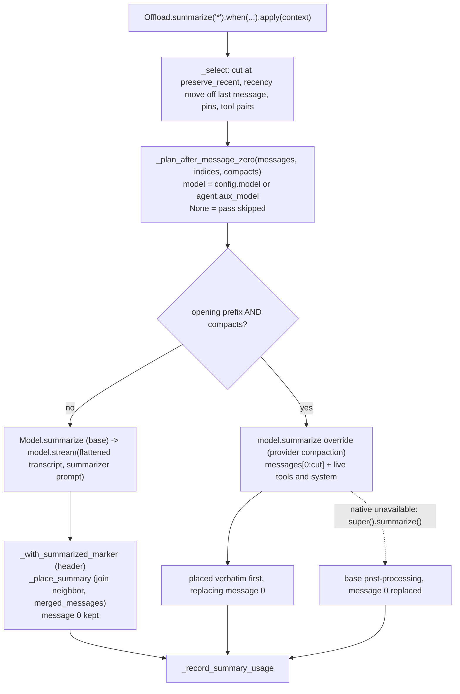
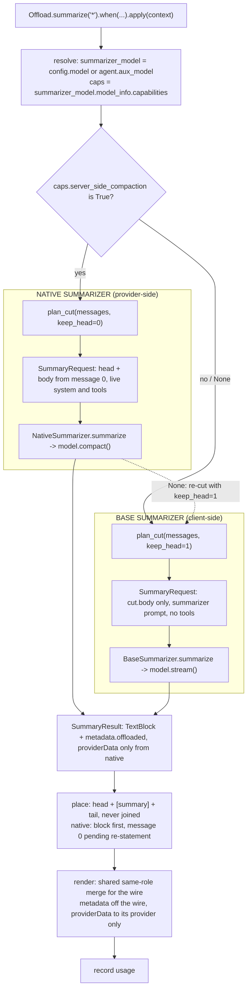
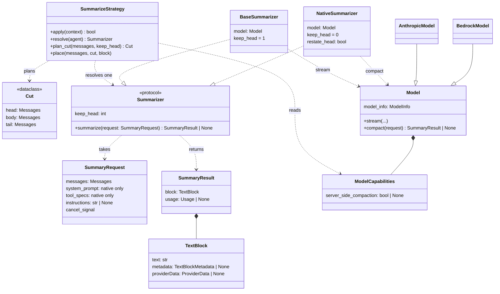

# Summarizer architecture for server-side compaction

**Date**: 2026-11-02

**Issue**: [#4933](https://github.com/strands-agents/harness-sdk/issues/4933), [#5410](https://github.com/strands-agents/harness-sdk/issues/5410)

**Scope**: Part 1 of #5410 (summarization). Part 2 (tool-result clearing, thinking clearing, tool-list changes) and Part 3 (other providers' compaction) are out of scope; they reuse the capability and `providerData` contracts defined here.

## Overview

The summarize strategy shortens long conversations by replacing older turns with a summary. On preserved-thinking Claude models (Claude Fable 5.1, Claude Opus 5.5, Claude Sonnet 5.5, Claude Haiku 5.5), any client-side rewrite of earlier history invalidates the thinking replayed after it. Anthropic's on-demand compaction (beta `compact-2026-09-04`) produces the summary server-side instead, but the returned block must be sent back exactly as returned and must come first.

This design proposes two summarizers behind one strategy:

- a `BaseSummarizer` that writes a client-side text summary, used by every provider;
- a `NativeSummarizer` that calls a new `Model.compact()`, used only when the summarizer model declares `server_side_compaction`.

A pure `plan_cut` decides what is summarized, every summary is its own message, and block metadata (not a text header) marks a summary. Python and TypeScript ship the same concepts and names.

The default experience doesn't change until native compaction can preserve the user's opening message; see [Rollout](#rollout).

## Problem

Developers running long agent sessions need the context manager to summarize older turns without breaking the next model call, and without silently changing what the agent remembers.

Preserved-thinking models bind each thinking block to the model and to the conversation prefix that produced it. If system, tools, or earlier messages change, replaying the block returns HTTP 400 ("bound to a different conversation"). Accounts created on or after 2026-08-31 enforce this by default; older accounts only when the request sets `thinking.block_binding.prefix_mismatch_behavior`. A client-side summary is exactly this kind of rewrite.

Strands has to support two summary operations with different contracts:

| | Base summary | Native compaction |
|---|---|---|
| Input | the selected body, after message 0 | the opening prefix, including message 0 |
| Request | summarizer prompt, no tools | live system prompt and tools |
| Output | text Strands may annotate | opaque block, sent back unchanged |
| Placement | after message 0 | first in `messages` |

The first attempt (#5470, unmerged) carries both through one `Model.summarize()` override. It works, but about 12 interlocking rules make it hard to change, the strategy file took 9 fix commits, and all of it is duplicated across SDKs. Three root causes:

1. One method carries both contracts.
2. Earlier summaries are found by matching a `[Summarized: N messages, T tokens]` text header, which a user can type.
3. Summaries are joined into neighbor messages, which needs role selection, block ordering, and `metadata.custom.merged_messages` offsets so stash refs keep resolving.

### Current State

On `main`, the summarize strategy writes a client-side summary on every provider. On a preserved-thinking model, the next request hits the binding 400. `AnthropicModel` and `BedrockModel` catch it and retry once with `drop_block` (`anthropic.py:1148`, `bedrock.py:583`). `drop_block` then stays on for every later request to that model. The only signal is one warning, and these models hide thinking text by default (`display: "omitted"`), so users can't see that reasoning was dropped. When thinking isn't a dict config (Sonnet 5.5's `between_tools`), the retry can't apply and the 400 reaches the user.

#5470 (open; resolves #5464) adds the experimental `Model.summarize()`. Read at its head (`b954286`):

- The override is detected by function identity (`_overrides_summarize`, `summarize.py:296`) and called only when `indices[0] == 0` (`:402`).
- `_is_text` sends text summaries through header insertion and neighbor joining. Under #5402, a native result is a `TextBlock` with `providerData`, so this code would rewrite and merge it, which Anthropic rejects (400 `compaction_signature_invalid` / `compaction_content_mismatch`).
- When native compaction is unavailable, `super().summarize()` returns text that replaces message 0.
- A fuzz run found that with `preserve_recent` ≤ 1, #5470 skips a pass that `main` summarizes in 85 of 3,000 histories (#5736). The built-in configs (`preserve_recent=4`, `0.7`) never hit this.

## Proposal

### Recommended: Split base and native summarizers behind a pure cut

#5470 is reworked into this split (#5733), so `Model.summarize()` never ships and needs no deprecation. All interfaces below are a proposed API.

1. **Resolve.** `summarizer_model = config.model or agent.aux_model`. `resolve(agent)` returns `NativeSummarizer` when `summarizer_model.model_info.capabilities.server_side_compaction is True`; `False` or `None` returns `BaseSummarizer`. Providers declare the value and developers override it through `model_info`. Wrappers report the inner model's `model_info`. No method-identity checks.
2. **Cut.** `plan_cut(messages, keep_head)` reads `preserve_recent` from the config and returns `Cut(head, body, tail)`. It's a pure function: tool pairs stay whole, roles alternate at the body/tail boundary, it stops at the first pin, and an earlier summary rolls into `body`. Each summarizer carries its own `keep_head`: base 1, native 0.
3. **Summarize.** `BaseSummarizer` sends `cut.body`, flattened, with the summarizer prompt and no live system or tools, through `model.stream`. `NativeSummarizer` sends `head + body` (starting at message 0) with live system and tools to `Model.compact()`; the tail isn't sent. If `compact()` returns `None`, the strategy re-cuts with `keep_head = 1` and runs the base path in the same pass.
4. **Result.** `SummaryResult.block` is a `TextBlock` with `metadata.offloaded = {method: "summarize"}`. Only native results carry `providerData` (#5402).
5. **Place.** `head + [summary] + tail`, never joined, so `merged_messages` goes away. On the native path the block is first, and `place()` records message 0 for re-statement.
6. **Render.** One shared pre-format step merges adjacent same-role messages for the wire without changing stored history. `metadata` never reaches the wire; `providerData` reaches only its own provider and renders as plain text elsewhere.
7. **Stale thinking.** Reactive `drop_block` stays the default. Where `block_binding` is unavailable, the provider strips the stale thinking itself. Dropped blocks are reported as a metric.

**Pros:**

- Removes all three root causes: one contract per summarizer, metadata instead of header matching, no joins.
- `plan_cut` is pure and property-testable in both SDKs, and the fuzz corpus from #5736 runs against it directly.
- A Haiku 5.5 `aux_model` can compact for Sonnet 5.5, which Anthropic documents as accepted.
- Thinking invalidation stays inside providers; the strategy never inspects reasoning blocks.

**Cons:**

- The wire for the base path is unchanged, but stored history now holds adjacent same-role messages (message 0 and a user-role summary), so every reader of `agent.messages` sees a new shape (O6).
- Native compaction replaces message 0 until mid-conversation system messages land (#5176), which is why native stays opt-in until then (O2).
- Stopping the cut at the first pin can summarize less than #5470 when a pin sits early (O3), and message-level target filters such as `"tool_results"` select non-contiguous messages that a contiguous `body` can't express (O4).
- Native behavior on Bedrock paths is undocumented or untested live (O1).
- Also affected by O5, O7, O9, O10.

### Alternative: Incremental routing (a), provider-owned placement (b), or always-strip (c)

- **(a) Merge #5470 and route on capability.** Keep `Model.summarize()`, replace the function-identity check with `server_side_compaction`, add a `providerData` guard to `_is_text`, and fix #5736 in the planner.
- **(b) Provider-owned placement.** The original version of this design: `Model.compact()` returns `[summary, ...preserved]` and each provider picks the cut and placement with a shared `compactionSplitIndex` helper, as specified in #5464.
- **(c) Always strip on the base path.** Native where available; on the base path, strip the tail's thinking before every request instead of relying on the reactive retry.

- **Pros:**
  - (a) Least new API. The code exists, passes its unit tests (Python 340, TS 214), and each fix is local.
  - (b) The provider owns its placement rules, so strategy code can't produce `compaction_block_misplaced`. One method covers both operations, matching the `count_tokens()` pattern.
  - (c) The base path never sends a stale block, the `between_tools` gap closes the same way as every other case, and behavior no longer depends on account creation date.
- **Cons:**
  - (a) Root causes 2 and 3 remain: header matching and neighbor joining stay, so every planner fix still touches role selection and offsets in both SDKs. It ships an experimental API this design would replace one release later.
  - (b) Each provider, including third-party ones, reimplements pin and tool-pair rules or calls a shared helper it can bypass. The strategy can't see what was summarized, so stash refs, usage accounting, and pins need a second channel back out.
  - (c) Discards tail reasoning even on accounts and models that wouldn't reject it, invisibly (`display: "omitted"`). It reverses the decision to keep reactive `drop_block` as the default.

## Developer Experience

Configuration is the existing strategy plus an optional summarizer model. All code is a proposed API; model IDs are placeholders.

```python
sonnet = AnthropicModel(model_id="<sonnet-5.5-id>")
haiku = AnthropicModel(
    model_id="<haiku-5.5-id>",
    # Opt in before the default flips (see Rollout).
    model_info=ModelInfo(capabilities=ModelCapabilities(server_side_compaction=True)),
)
agent = Agent(model=sonnet, aux_model=haiku)  # SummarizeConfig(model=...) overrides aux_model
strategy = Offload.summarize("*").when(utilization=0.7, preserve_recent=3)

converse = BedrockModel(model_id="<bedrock-model-id>")  # server_side_compaction=False -> base path
sonnet.client = AsyncAnthropicBedrockMantle(...)        # Mantle or InvokeModel: test-only today
```

```ts
const haiku = new AnthropicModel({
  modelId: '<haiku-5.5-id>',
  modelInfo: { capabilities: { serverSideCompaction: true } },
})
const agent = new Agent({ model: sonnet, auxModel: haiku })
const strategy = Offload.summarize('*').when({ utilization: 0.7, preserveRecent: 3 })
```

- **Routing.** `True` uses native compaction. `False` or unknown uses the base summary, which keeps message 0 and stores the summary after it.
- **Fallback.** If `compact()` returns `None` (for example, a path without on-demand compaction), the same pass re-cuts with message 0 kept and writes a base summary. No error reaches the caller.
- **Reading history.** A summary is `block.metadata.offloaded.method == "summarize"`, never a text prefix.

Warning when reasoning is dropped:

```
model_id=<sonnet-5.5-id> | history edit invalidated replayed thinking blocks, retrying with drop_block
```

| Error | Cause | Handling |
|---|---|---|
| 400 `compaction_block_misplaced` | summarized messages in front of the block | `place()` puts the block first |
| 400 "bound to a different conversation" | replayed thinking after a history edit | provider retries once with `drop_block` |
| `between_tools` gap | retry can't apply | provider strips stale thinking (proposed) |
| `TypeError` on `params={"compaction": ...}` | not a supported parameter | use `extra_body` today; first-class in #5401 |

## Additional Details

<details>
<summary>Extended context</summary>

### Rollout

The goal is no change for users who don't opt in until each step is safe.

1. **Split lands (#5733).** `AnthropicModel` declares `server_side_compaction=None`, so everyone takes the base path. Stored summaries change shape (metadata, separate message); the wire for the base path doesn't. Old sessions keep loading (see Decisions needed, D3).
2. **Native lands (#5401).** Opt-in only, through `model_info`. Opting in accepts that message 0 is replaced by the summary.
3. **Re-statement lands (#5176, then `restate_head`).** `AnthropicModel` declares `True` for preserved-thinking model IDs. From here, preserved-thinking users get native compaction by default, with message 0 re-stated. Docs (#5405) call out the behavior and cost change.

### Anthropic compaction rules

From [compaction-on-demand](https://platform.claude.com/docs/en/build-with-claude/compaction-on-demand) and [compaction-thinking-blocks](https://platform.claude.com/docs/en/build-with-claude/compaction-thinking-blocks):

- On-demand compaction (top-level `compaction: {type: "summarize"}`) returns one compaction block: summary text plus a signature.
- The block must be first in `messages`; summarized messages left in front of it cause 400 `compaction_block_misplaced`.
- A later request can use a different system, tools, or model from the compaction request. Haiku 5.5 can compact for Sonnet 5.5, but can't read Sonnet 5.5's thinking, so the summary is written without it.
- Kept turns' thinking stays valid when the compaction ran on a preserved-thinking model, the kept turns directly follow the summarized ones unchanged, the first kept message differs in role from the last summarized one and isn't `role: "system"`, and system and tools are unchanged.
- To keep an instruction in force, re-state it as a `role: "system"` message directly after the first new user turn that follows the kept turns. A system message between the block and the kept turns breaks their thinking.
- A model switch never causes a 400. Blocks the current model can't read are dropped (`model_binding_mismatch`) with a 200.

### Provider paths

Documented support (docs fetched 2026-11-02):

| Path | On-demand compaction | Threshold compaction | Block-binding |
|---|---|---|---|
| Anthropic first-party | beta | beta | beta |
| Claude Platform on AWS | beta | beta | supported |
| Bedrock InvokeModel | not documented | beta | not documented |
| Bedrock Mantle | not documented | beta | not documented |
| Bedrock Converse | not documented | not documented | not documented |

What Strands sends, from mocked-transport runs (not live):

- `AnthropicModel` reaches all four Anthropic clients when `model.client` is assigned after construction; `__init__` hard-codes `AsyncAnthropic`. The `drop_block` retry worked against all four.
- `params={"compaction": ...}` raises `TypeError`. Compaction works via `extra_body`, betas via `extra_headers["anthropic-beta"]`. InvokeModel copies betas into the body only from per-request headers.
- `BedrockModel` passes `thinking`, `anthropic_beta`, and `compaction` unchanged in `additionalModelRequestFields`. What Converse returns for them is unknown; its response has no field for a compaction block.
- `VercelModel` doesn't round-trip reasoning signatures until #5532, has no binding retry, and drops text metadata. The installed `@ai-sdk/anthropic` appears to strip `thinking.block_binding` (unverified).
- LiteLLM drops signatures on the way back in.

### Current flow (#5470, unmerged)



### Target flow (proposed)



### Classes (proposed)



`AnthropicModel.compact()` calls `compact-2026-09-04`. `BedrockModel.compact()` returns `None` and its capability is `False`. Both strip thinking a summary invalidated where `drop_block` can't apply.

### Previously considered

From earlier revisions of this design, still rejected:

- **A `CompactionBlock` content type.** Widens the public content-block union; every provider that can't send it must reject or convert it. `providerData` on `TextBlock` (#5402) degrades to text instead.
- **Storing only the summary text, discarding the signature.** The API can't tell it from a client summary, so kept turns' thinking is invalidated and native compaction offers nothing over a base summary.
- **A `requiresServerSideCompaction` config flag.** Can't represent "unknown", and duplicates model metadata capabilities.

### Implementation plan

Each row is one PR per SDK, or one PR with both and parity noted in the description. Every PR passes the `ci.yml` merge gate, carries its cognitive-complexity label (checked with `npm run complexity` / `hatch run complexity`), and runs any `tests_integ` it adds in CI.

| # | Deliverable | Scope | Depends on | Acceptance criteria | Tests | Risk |
|---|---|---|---|---|---|---|
| 1 | `TextBlock.metadata.offloaded` | TS: #5325. Python: `types/content`, offload strategies | — | Drop/truncate placeholders are detected by `metadata.offloaded`, not regex; metadata round-trips through session save/restore in both SDKs and never reaches a provider request | unit: round-trip, every formatter omits metadata | #5325 is a larger breaking change; Python needs its own PR |
| 2 | `providerData` on `TextBlock` (#5402) | content types, session serialization, every provider formatter | 1 | A block with `providerData` for provider X renders natively on X and as plain text on every other provider; restored sessions keep it | unit per formatter; mocked-wire for Anthropic | Missing a formatter leaks opaque data |
| 3 | `server_side_compaction` capability (#5466) | `_model_info.py` / `model-info.ts`, wrappers | — | Field exists, defaults `None`; wrappers report the inner model's value; `model_info` override wins | unit | Name must match #5466 and #5405 |
| 4 | Pure `plan_cut` | `offload/summarize.py`, `offload/summarize.ts` | — | `plan_cut` has no I/O; tool pairs never split; body/tail roles alternate; stops at first pin; earlier summary rolls into body; #5736 fuzz corpus passes with no skipped pass | unit + property tests, shared fixtures across SDKs | Behavior change for early pins (O3) |
| 5 | Summarizer split (#5733, rework of #5470) | `offload/summarize.*`, `models/_summarize.py`, `models/summarize.ts`, `models/model.*` | 1, 3, 4 | No `Model.summarize()`, no `_overrides_summarize`, no `[Summarized:` string match on write; `BaseSummarizer` path places `head + [summary] + tail`; `Model.compact()` exists and returns `None` by default; `None` re-cuts with `keep_head=1` | unit: both paths, fallback, usage recorded once per pass | Largest PR; split into base and native-scaffold PRs if it crosses the complexity label |
| 6 | Shared same-role merge at render | shared pre-format step used by every provider | 5 | Stored history unchanged after a request; every provider receives alternating roles; base-path wire bytes match `main` for the same history | unit per provider; mocked-wire Anthropic, Bedrock | A third-party provider that bypasses the shared step (O6) |
| 7 | Session compatibility | summarize strategy read path | 5 | A session saved with the `[Summarized:` header is recognized as a summary for one release; a new session never contains the header | unit with saved fixtures | Dual detection lingers past one release |
| 8 | Anthropic native compaction (#5401) | `models/anthropic.*` | 2, 5 | `compact()` sends `compact-2026-09-04` with live system and tools; returns `None` when unavailable; result carries `providerData` and is sent back byte-identical; `compaction` is a first-class parameter; capability stays `None` (opt-in) | unit; mocked-wire T3 scenarios; integ on first-party | Beta API changes |
| 9 | Provider-owned stripping for `between_tools` | `models/anthropic.*`, `models/bedrock.*`, `_thinking_binding.py` / `thinking-binding.ts` | 5 | Where `block_binding` can't be set, stale thinking after a summary is stripped before send; no 400 reaches the caller in the T3 `between_tools` scenario | unit; mocked-wire | Strips reasoning that would have been accepted |
| 10 | Usage and dropped-thinking metrics (#5404) | `models/anthropic.*`, `models/bedrock.*`, telemetry | 8, 9 | Compaction and base summary usage appear in `AgentResult.metrics`; dropped blocks from `input_transformations` and `drop_block` retries are counted | unit; mocked-wire hooks | Metric name parity |
| 11 | Native head re-statement | summarize strategy, Anthropic formatter | #5176, 8 | `place()` records message 0; it is sent as `role: "system"` after the first new user turn following the kept turns; kept thinking stays valid | unit; integ `compact_keep3` | Timing (O2) |
| 12 | Default flip and docs (#5405) | `AnthropicModel` capability table, site docs | 11, validation V4 | Preserved-thinking IDs declare `True`; docs cover routing, opt-out, cost, and the provider matrix | integ T4 matrix; docs build | User-visible behavior change |

Follow-ups, not in this plan (T7): a supported `client=` parameter on `AnthropicModel`; `VercelModel` text-metadata round trip, binding retry, and `block_binding` support (after #5532); LiteLLM signature capture.

### Validation plan

**Existing evidence.** Source reads at #5470's head; mocked-transport runs of all four `AnthropicModel` clients and `BedrockModel`; the two Anthropic docs pages. None of this shows live provider support.

**New unit tests.** `plan_cut` property tests with the #5736 corpus; both summarizers; `None` fallback; render merge per provider; metadata and `providerData` round-trips; session fixtures with the old header. Offline tests use a transport that raises on any unmocked request, because `client.with_options(...)` on the Bedrock and Mantle clients drops a custom `http_client` and sent real requests in earlier runs.

**New mocked-wire tests.** The T3 scenarios with the retry bypassed, asserting request shape only: block first, byte-identical round trip, betas in the body for InvokeModel and in a header for Mantle.

**New integration tests (`tests_integ`, CI on the PR).** First-party Anthropic: T3 scenarios with `prefix_mismatch_behavior: "error"`, A = Sonnet 5.5, B = Haiku 5.5.

| Scenario | Expected |
|---|---|
| append_only | 200 |
| prefix_edit | 400 binding |
| model_switch | 200, A's blocks dropped |
| compact_same | 200, nothing dropped |
| compact_cross (B compacts) | 200 |
| compact_keep3 | 200, kept thinking valid |
| client_summary | 400 binding |
| base_summary_drop | 200, tail dropped |
| drop_block on Sonnet 4.6 | 200 |
| block_binding with `between_tools` | 400 field rejected |

**Live work needing credentials beyond CI.**

| ID | Experiment | Settles | Result that settles it |
|---|---|---|---|
| V1 | On-demand compaction and `input_transformations` on InvokeModel and Mantle; Converse response for `compaction` | O1 | 200 with a compaction block → native allowed on that path; anything else → capability `False` there |
| V2 | T4 matrix: `AnthropicModel` four clients, `BedrockModel`, `VercelModel` after #5532, × four models × base / native / native with Haiku 5.5 `aux_model`; multi-turn tool task forcing 2–3 passes, `preserve_recent=3` | O1, O6 | No 400 reaches the caller; message 0 kept (base) or re-stated (native); native only when the capability is `True` |
| V3 | Pin and filter replay: built-in configs over recorded histories with early pins and `"tool_results"` filters | O3, O4 | Tokens reclaimed close to #5470's planner (threshold to agree in review), or a documented regression accepted |
| V4 | #5734 evaluation: fact recall and task success over repeated passes, base vs native, `keep_head` 0 vs 1 | O7 | Native recall ≥ base before the default flips; chosen prompt for #5735 |
| V5 | T5 metrics on V2 runs: `drop_block` retries (log handler), dropped blocks (response hooks), compaction vs fallback counts, tokens/cost/latency | O8 | Retry count per session; if retries are routine on preserved-thinking IDs, revisit D4 |

### Decisions needed

| # | Question | Recommendation | Cost |
|---|---|---|---|
| D1 | Default native on, or opt-in until #5176 + re-statement? (O2) | Opt-in until row 11 lands; fall back to summarizer instructions asking to keep the task for models without system messages | Preserved-thinking users keep paying `drop_block` reasoning loss until then |
| D2 | Where does same-role merging happen? (O6) | One shared pre-format step, called by every vended provider and documented for third-party ones | Third-party providers that format raw history must adopt it |
| D3 | Saved sessions with the `[Summarized:` header (O5) | Read-time dual detection for one release, then remove | One more release of string matching on read |
| D4 | Set `drop_block` up front for preserved-thinking IDs, or only reactively? (O8) | Reactive, pending V5 | One failed request per model per session |
| D5 | `compact()` on `Model` or a separate protocol? (O9) | On `Model`, returning `None` by default: it needs the provider client, and capability routing already gates it | One more method on the base class |
| D6 | Message-level target filters with a contiguous body (O4) | Filters select blocks within `body`; non-contiguous message selection isn't supported for summaries | Pending V3 |
| D7 | Cut stops at the first pin (O3) | Keep, pending V3 | Possible smaller reclaim for early pins |
| D8 | `keep_head` default and prompt (O7) | Base 1 until #5734 reports | Possible drift across rolling summaries |

O10: #5470, #5325, #5402, #5466, #5401, and #5176 are open. No row above treats their contracts as landed. Release gates beyond CI and deadlines: none known.

</details>
